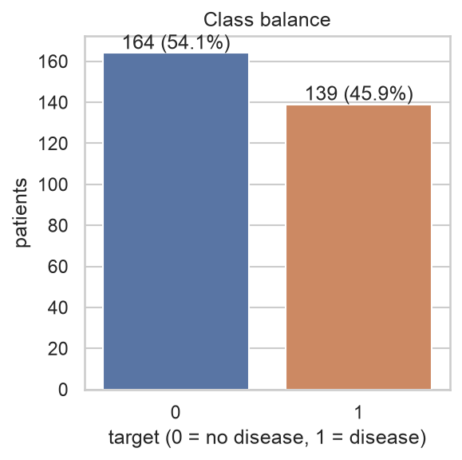
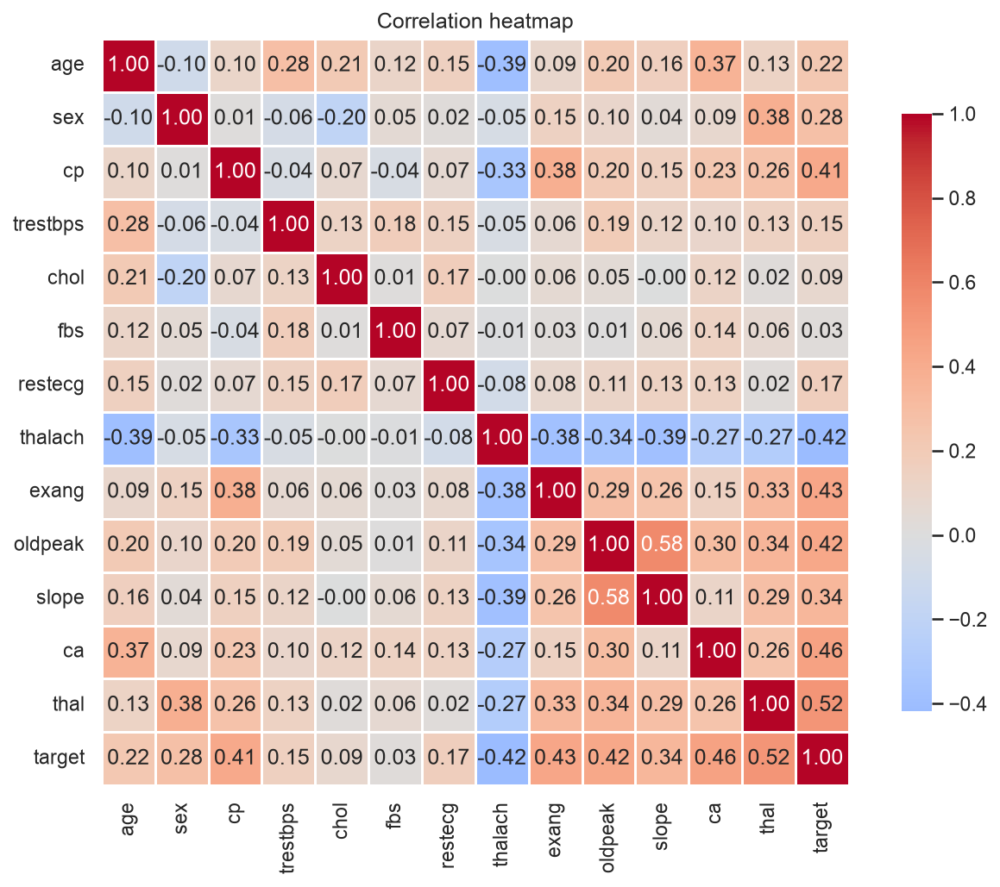
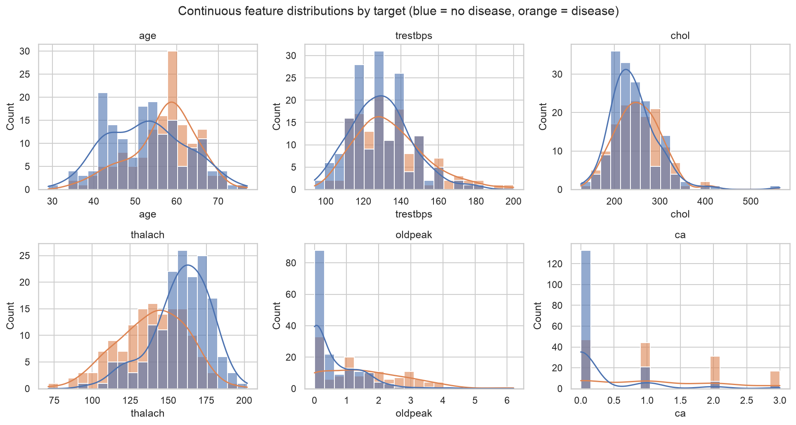
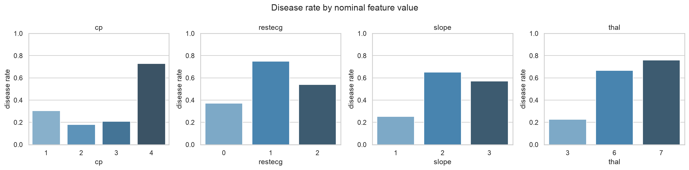
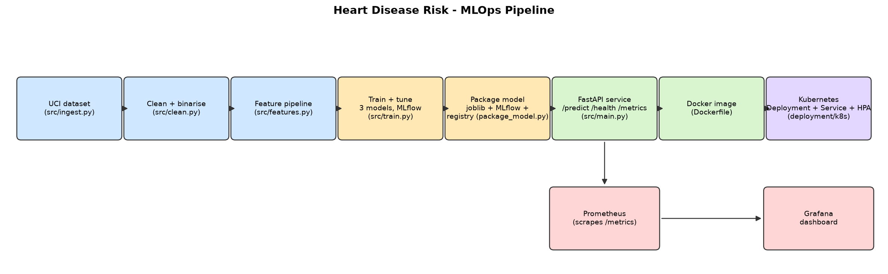

# Heart Disease Risk Prediction — MLOps Assignment 1 Report

|                      |                                                                                                   |
| -------------------- | ------------------------------------------------------------------------------------------------- |
| **Course**     | Machine Learning Operations (MLOps), AIMLCZG523                                                   |
| **Assignment** | Assignment 1 — End-to-End ML Model Development, CI/CD, and Production Deployment                 |
| **Author**     | Sibasis Mishra (2025AE05040)                                                                      |
| **Repository** | [github.com/is-zen-genius/mlops_assignment_1](https://github.com/is-zen-genius/mlops_assignment_1) |
| **Date**       | 2026-10-20                                                                                        |

### Submission links

- Project video: [GitHub video](https://github.com/is-zen-genius/mlops_assignment_1/blob/main/recordings/mlops_2025ae05040.mov)
- Project video: [Google Drive folder](https://drive.google.com/drive/folders/1UO6gMZc_yPuTMv8h-T_kK07NyMYBEhN2)

---

## Table of contents

1. [Problem statement &amp; dataset](#1-problem-statement--dataset)
2. [Setup / install instructions](#2-setup--install-instructions)
3. [Data acquisition &amp; EDA](#3-data-acquisition--eda)
4. [Feature engineering &amp; model development](#4-feature-engineering--model-development)
5. [Experiment tracking (MLflow)](#5-experiment-tracking-mlflow)
6. [Model packaging &amp; reproducibility](#6-model-packaging--reproducibility)
7. [CI/CD pipeline &amp; automated testing](#7-cicd-pipeline--automated-testing)
8. [Model containerisation](#8-model-containerisation)
9. [Production deployment (Kubernetes)](#9-production-deployment-kubernetes)
10. [Monitoring &amp; logging](#10-monitoring--logging)
11. [Architecture diagram](#11-architecture-diagram)
12. [Results summary](#12-results-summary)
13. [Production-readiness requirements — evidence](#13-production-readiness-requirements--evidence)
14. [Repository layout](#14-repository-layout)

---

## 1. Problem statement & dataset

Predict the presence of heart disease from 13 patient health measurements (age, sex, chest pain
type, resting blood pressure, cholesterol, fasting blood sugar, resting ECG, max heart rate,
exercise-induced angina, ST depression, ST slope, number of vessels coloured, thalassemia), and
serve that model as a monitored, containerised, Kubernetes-deployed REST API.

- **Source:** UCI Machine Learning Repository, Heart Disease (Cleveland) dataset —
  `processed.cleveland.data` (14 columns, 303 rows, the last column `num` is a 0-4 severity score).
- **Target:** binarised to `0` (no disease) / `1` (disease present, `num > 0`).

## 2. Setup / install instructions

```bash
git clone https://github.com/<your-username>/<your-repo>.git
cd <your-repo>

python3.12 -m venv .venv
source .venv/bin/activate              # Windows: .venv\Scripts\activate

pip install --upgrade pip
pip install -r requirements.txt    # one file: training, serving, tests, lint, notebooks, report
```

Reproduce the whole pipeline from a clean checkout:

```bash
ruff check src tests scripts \
  && pytest \
  && python src/ingest.py \
  && python src/clean.py \
  && python src/train.py \
  && python src/package_model.py \
  && python src/inference.py
```

Run the API locally without Docker:

```bash
PYTHONPATH=src uvicorn main:app --app-dir src --host 0.0.0.0 --port 8001 --reload
# Swagger UI: http://localhost:8001/docs   Health: /health   Metrics: /metrics
```

## 3. Data acquisition & EDA

`src/ingest.py` downloads `processed.cleveland.data` straight from the UCI repository and writes
`data/raw/heart_disease_raw.csv` (303 rows × 14 columns); `--source <file>` lets it convert an
already-downloaded copy instead, for offline/air-gapped grading environments.

`src/clean.py` then:

1. Drops exact duplicate rows.
2. Binarises `num` (0-4 severity) into `target` (0/1).
3. Imputes the only two columns with missing values — `ca` (4 missing) and `thal` (2 missing) —
   with the column mode.
4. Casts categorical columns to `int`.

The full analysis, with executed outputs, is in
[notebooks/01_exploratory_data_analysis.ipynb](../notebooks/01_exploratory_data_analysis.ipynb).
Headline findings:

- **Class balance:** 54.1% no-disease vs. 45.9% disease — mild imbalance, not severe enough to
  need resampling, but `src/train.py` still tries `class_weight="balanced"` during tuning.
- **Strongest univariate correlations with target:** `thal` (0.52), `ca` (0.46), `exang` (0.43),
  `oldpeak` (0.43), `thalach` (0.42), `cp` (0.41). No pair of features is collinear enough
  (all |r| < 0.6) to justify dropping one.
- **`cp`, `restecg`, `slope`, `thal` are not ordinal** — e.g. disease rate for `cp` is
  30% / 18% / 21% / 73% for codes 1-4 respectively, which isn't monotonic — so they are one-hot
  encoded rather than treated as numbers.
- **`ca` (vessels coloured, 0-4) behaves like a count** — disease rate increases roughly
  monotonically with more vessels coloured, so it's scaled as a numeric feature instead.






*(regenerate these with `python scripts/export_eda_figures.py`; the full interactive analysis,
including the missing-value chart, is in the notebook linked above)*

## 4. Feature engineering & model development

`src/features.py` builds a single `ColumnTransformer` (`build_preprocessor()`) shared by training
and serving, split into three groups defined in `src/config.py`:

| Group                      | Columns                                       | Treatment                                                         |
| -------------------------- | --------------------------------------------- | ----------------------------------------------------------------- |
| Continuous / ordinal count | `age, trestbps, chol, thalach, oldpeak, ca` | median-impute + `StandardScaler`                                |
| Already binary             | `sex, fbs, exang`                           | most-frequent-impute, used as-is                                  |
| Nominal (unordered)        | `cp, restecg, slope, thal`                  | most-frequent-impute + `OneHotEncoder(handle_unknown="ignore")` |

This is a deliberate improvement over "one-hot encode everything non-numeric": `ca` keeps its
natural order (more vessels coloured = worse) instead of exploding into 5 dummy columns, and
unseen categories at inference time are safely ignored rather than crashing the service.

`src/train.py` trains and tunes **three** classifiers (the assignment requires at least two) with
`GridSearchCV` (`scoring="roc_auc"`) over `StratifiedKFold(n_splits=5)`:

| Model               | Grid searched                                                                                  |
| ------------------- | ---------------------------------------------------------------------------------------------- |
| Logistic Regression | `C ∈ {0.01, 0.1, 1, 10}`, `class_weight ∈ {None, balanced}`                              |
| Random Forest       | `n_estimators ∈ {200, 400}`, `max_depth ∈ {None, 5, 10}`, `min_samples_leaf ∈ {1, 3}` |
| Gradient Boosting   | `n_estimators ∈ {100, 200}`, `learning_rate ∈ {0.01, 0.1}`, `max_depth ∈ {2, 3}`      |

A held-out 20% test split (stratified, `random_state=42`) is scored after refitting each model's
best candidate on the full training split. See [Section 12](#12-results-summary) for the numbers.

## 5. Experiment tracking (MLflow)

- **Tracking store:** SQLite (`sqlite:///tracking.db`) so the MLflow **Model Registry** is
  available (the plain local file store doesn't support it in older MLflow releases).
- **Experiment:** `heart-disease-risk`. One parent run per model family, with:
  - params: `model_family`, `test_size`, `cv_folds`, `random_state`, `param_grid`, best
    hyper-parameters;
  - metrics: `cv_roc_auc` plus `test_accuracy/precision/recall/f1/roc_auc`;
  - artifacts: confusion matrix, ROC curve and precision-recall curve PNGs, the full grid-search
    results table (`cv_results_<model>.csv`), and the fitted sklearn pipeline
    (`mlflow.sklearn.log_model`).
  - the **top-5** grid-search candidates per family are logged as **nested child runs**
    (`candidate_rank1` … `candidate_rank5`) so the search can be inspected without flooding the
    experiment with every single combination.
- **Model Registry:** `src/package_model.py` finds the run tagged `selected_as_best=true` and
  registers it as `heart-risk-classifier`, then points the **`champion`** alias at that version
  (`MlflowClient.set_registered_model_alias`), so consumers can resolve
  `models:/heart-risk-classifier@champion` instead of hard-coding a run id.

```bash
mlflow ui --backend-store-uri sqlite:///tracking.db --port 5000
# open http://localhost:5000 -> experiment "heart-disease-risk"
```

## 6. Model packaging & reproducibility

`src/package_model.py` produces three artifacts from the winning run:

1. **`models/model.joblib`** — the fitted `Pipeline` (preprocessing + classifier), loaded directly
   by `src/inference.py` and the API.
2. **`models/model_metadata.json`** — metrics, best hyper-parameters, the feature schema, a
   SHA-256 of both the training data and the model file, and the exact Python/scikit-learn/MLflow
   versions used to train it (full reproducibility audit trail).
3. **`models/mlflow_model/`** — an MLflow "sklearn"-flavour copy, servable standalone with
   `mlflow models serve -m models/mlflow_model --port 5001 --env-manager local`.

A **round-trip check** reloads both the joblib and MLflow copies and asserts their predicted
probabilities are numerically identical (`np.allclose`) before packaging is considered successful.

Reproducibility is also pinned at the dependency level: a single `requirements.txt` (one file,
used by local dev, the test suite, the Docker image and CI alike — see
[Section 7](#7-cicd-pipeline--automated-testing) and [Section 8](#8-model-containerisation)) uses
exact `==` versions resolved from a clean install, and `model_metadata.json` records the exact
versions used at training time for comparison. A from-scratch install was verified during this
submission: a brand-new virtualenv, `pip install -r requirements.txt`, then `pytest` (25 passed)
and `ruff check src tests scripts` (0 errors) — proving the single requirements file is sufficient
and self-contained.

## 7. CI/CD pipeline & automated testing

[.github/workflows/ci.yml](../.github/workflows/ci.yml) runs on every push to `main`, every pull
request, and manual dispatch, as four sequential jobs — **each one gates the next** (`needs:`), so
a lint or test failure stops the pipeline before it ever trains a model or builds an image:

| Job        | What it does                                                                                                                                                      | Artifact uploaded                       |
| ---------- | ----------------------------------------------------------------------------------------------------------------------------------------------------------------- | --------------------------------------- |
| `lint`   | `ruff check src tests scripts`                                                                                                                                  | `ruff-report.txt`                     |
| `test`   | `pytest --junitxml=... --cov=src` (25 unit/API tests)                                                                                                           | `pytest-report.xml`, `coverage.xml` |
| `train`  | ingest → clean → train (MLflow) → package → CLI smoke test                                                                                                    | `models/`, `reports/`, `mlruns/`  |
| `docker` | builds the image from the `train` job's artifacts, runs it, polls `/health` until Docker reports `healthy`, then calls `/predict` with the sample patient | container logs (on failure)             |

25 tests across 5 files cover data cleaning, the feature pipeline, model evaluation/
reproducibility, the inference helper, and the FastAPI endpoints (validation, metrics, headers):

```bash
pytest                          # 25 passed
ruff check src tests scripts    # 0 errors
```

### Fail-fast demonstration (real, reproduced for this submission)

The production-readiness requirement *"Pipeline must fail on code or test errors and give clear
logs"* was verified directly, not just asserted: a throwaway failing test and a throwaway lint
violation were added, run, and then removed again (neither is part of the committed code).

**1. A deliberately failing test** (`tests/test_zz_demo_failure.py`,
`assert 1 == 2`) was added and run:

```text
$ pytest -q
tests/test_api.py .......                                                    [ 26%]
tests/test_clean.py ......                                                   [ 50%]
tests/test_features.py ......                                                [ 73%]
tests/test_inference.py ...                                                  [ 84%]
tests/test_train.py ...                                                      [ 96%]
tests/test_zz_demo_failure.py F                                              [100%]

================================== FAILURES ===================================
_________________ test_deliberately_wrong_prediction_threshold _______________

    def test_deliberately_wrong_prediction_threshold():
>       assert 1 == 2, "intentional failure to demonstrate pipeline fail-fast behaviour"
E       AssertionError: intentional failure to demonstrate pipeline fail-fast behaviour
E       assert 1 == 2

tests/test_zz_demo_failure.py:8: AssertionError
=========================== short test summary info ===========================
FAILED tests/test_zz_demo_failure.py::test_deliberately_wrong_prediction_threshold
=================== 1 failed, 25 passed, 3 warnings in 1.40s ===================
$ echo "exit code: $?"
exit code: 1
```

A non-zero exit code here is exactly what makes the `test` job (and therefore `train` and
`docker` after it) fail in CI — GitHub Actions marks the job red and the run stops.

**2. A deliberate lint violation** (`scripts/zz_demo_lint_fail.py`, two unused imports) was added
and linted:

```text
$ ruff check src tests scripts
F401 [*] `os` imported but unused
 --> scripts/zz_demo_lint_fail.py:2:8
  |
1 | """Throwaway file used once to capture what a ruff failure looks like for the report."""
2 | import os
  |        ^^
3 | import sys  # unused import -> F401
  |
help: Remove unused import: `os`

F401 [*] `sys` imported but unused
 --> scripts/zz_demo_lint_fail.py:3:8
  |
2 | import os
3 | import sys  # unused import -> F401
  |        ^^^
help: Remove unused import: `sys`

Found 2 errors.
[*] 2 fixable with `--fix`.
$ echo "exit code: $?"
exit code: 1
```

Both throwaway files were deleted immediately after capturing this evidence; `pytest` and
`ruff check src tests scripts` are green again (confirmed: 25 passed, 0 errors) in the committed
state. This demonstrates, with real command output rather than just a description, that both the
`lint` and `test` jobs fail loudly and specifically (exact file, line, assertion/rule) rather than
silently continuing — satisfying the "fail on code or test errors and give clear logs"
requirement.

## 8. Model containerisation

The [Dockerfile](../Dockerfile) is a **multi-stage** build:

1. `builder` stage: installs the project's single `requirements.txt` into a throwaway virtualenv.
2. `runtime` stage: starts from a fresh `python:3.12-slim`, copies that venv and only the seven
   source files the API actually imports (`config, features, inference, schemas, metrics, logging_utils, main`) plus `models/model.joblib`, runs as a **non-root user**, and exposes
   **8001** with a `HEALTHCHECK` hitting `/health`.

> **Trade-off, noted explicitly:** using one `requirements.txt` everywhere (simpler to maintain
> and document — see `README.md`) means the image also contains training/notebook/report
> dependencies (MLflow, matplotlib, Jupyter, python-docx, ...) that the running API doesn't need.
> The image is ~1.1 GB instead of the ~550 MB a slimmed-down `requirements-api.txt` gave. The
> multi-stage build, non-root user and minimal `COPY` list are kept regardless, so this only
> affects image size, not the attack surface of what's actually imported/executed at runtime.

### Build + isolated-environment serving proof (real, reproduced for this submission)

```text
$ docker build -t heart-risk-api:1.0 .
...
#17 writing image sha256:96e4b1bbe621cc9615cfb5b29fcb64ae09792de80a13256f1fdb628bc480abbd
#17 naming to docker.io/library/heart-risk-api:1.0 done

$ docker images heart-risk-api:1.0
REPOSITORY       TAG       IMAGE ID       CREATED          SIZE
heart-risk-api   1.0       96e4b1bbe621   16 seconds ago   1.11GB

$ docker run -d --name heart-risk-api-proof -p 8001:8001 heart-risk-api:1.0
2a41f4f079e57b713fa02f880dbe07491f470b9d2f39b2d6a2e317a14dcddb6f

$ docker inspect --format='{{.State.Health.Status}}' heart-risk-api-proof
healthy

$ curl -sS http://localhost:8001/health
{"status":"ok","model_loaded":true}

$ curl -sS -X POST http://localhost:8001/predict -H "Content-Type: application/json" \
    -d @data/sample_patient.json
{"prediction":0,"label":"no disease","confidence":0.7999,"probability_disease":0.2001}

$ curl -sS -o /dev/null -w 'HTTP %{http_code}\n' -X POST http://localhost:8001/predict \
    -H "Content-Type: application/json" -d '{"age": 9999}'
HTTP 422

$ docker logs heart-risk-api-proof | grep '"event"'
{"timestamp": "2026-10-20T05:29:57.398+00:00", "level": "INFO", "logger": "heart_api", "message": "model loaded", "event": "startup"}
{"timestamp": "2026-10-20T05:31:08.874+00:00", "level": "INFO", "logger": "heart_api", "message": "prediction served", "event": "prediction", "prediction": 0, "confidence": 0.7999}
{"timestamp": "2026-10-20T05:31:08.874+00:00", "level": "INFO", "logger": "heart_api", "message": "request handled", "event": "request", "request_id": "1009e3d61a06", "method": "POST", "path": "/predict", "status": 200, "duration_ms": 27.03}
{"timestamp": "2026-10-20T05:31:08.896+00:00", "level": "INFO", "logger": "heart_api", "message": "request handled", "event": "request", "request_id": "dc70f7888a6b", "method": "POST", "path": "/predict", "status": 422, "duration_ms": 0.57}

$ docker stop heart-risk-api-proof && docker rm heart-risk-api-proof
```

This is the "Model must serve correctly in an isolated environment" proof: a freshly built image,
with no bind-mounted source and no host Python environment involved, serves correct predictions,
rejects invalid input with `422`, reports a passing Docker `HEALTHCHECK`, and emits structured
JSON logs — then is cleanly stopped and removed.

## 9. Production deployment (Kubernetes)

Manifests in [deployment/k8s/](../deployment/k8s/) (apply in filename order):

| File                         | Resource                                                                                                                                                           |
| ---------------------------- | ------------------------------------------------------------------------------------------------------------------------------------------------------------------ |
| `00-namespace.yaml`        | Namespace `heart-risk`                                                                                                                                           |
| `10-configmap.yaml`        | `LOG_LEVEL` for the API container                                                                                                                                |
| `20-deployment.yaml`       | Deployment, 2 replicas, rolling update (`maxUnavailable: 0`), readiness/liveness probes on `/health`, non-root, dropped capabilities, resource requests/limits |
| `30-service.yaml`          | `LoadBalancer` Service, port **8080** → container port 8001                                                                                               |
| `35-service-headless.yaml` | Headless Service so Prometheus discovers every pod individually                                                                                                    |
| `40-hpa.yaml`              | HorizontalPodAutoscaler, 2-5 replicas on 70% CPU (bonus, needs `metrics-server`)                                                                                 |

### Full deployment walkthrough — real, reproduced for this submission

Tested end-to-end on a local Kubernetes cluster (Rancher Desktop / k3s). The cluster context was
confirmed before touching anything, without printing any other (corporate) cluster details:

```text
$ kubectl config current-context
rancher-desktop
```

**1. Create the namespace, then the rest of the API manifests:**

```text
$ kubectl apply -f deployment/k8s/
namespace/heart-risk created
configmap/heart-risk-api-config created
deployment.apps/heart-risk-api created
service/heart-risk-api created
service/heart-risk-api-headless created
horizontalpodautoscaler.autoscaling/heart-risk-api created

$ kubectl rollout status deployment/heart-risk-api -n heart-risk --timeout=90s
Waiting for deployment "heart-risk-api" rollout to finish: 0 of 2 updated replicas are available...
Waiting for deployment "heart-risk-api" rollout to finish: 1 of 2 updated replicas are available...
deployment "heart-risk-api" successfully rolled out
```

**2. Inspect everything that got created:**

```text
$ kubectl get all -n heart-risk -o wide
NAME                                  READY   STATUS    RESTARTS   AGE   IP
pod/heart-risk-api-677b56f558-25gh7   1/1     Running   0          22s   10.42.0.86
pod/heart-risk-api-677b56f558-bwtsb   1/1     Running   0          22s   10.42.0.85

NAME                              TYPE           CLUSTER-IP      EXTERNAL-IP    PORT(S)
service/heart-risk-api            LoadBalancer   10.43.100.182   192.168.64.2   8080:32039/TCP
service/heart-risk-api-headless   ClusterIP      None            <none>         8001/TCP

NAME                             READY   UP-TO-DATE   AVAILABLE
deployment.apps/heart-risk-api   2/2     2            2

NAME                                        DESIRED   CURRENT   READY
replicaset.apps/heart-risk-api-677b56f558   2         2         2

NAME                                                 REFERENCE                   TARGETS       MINPODS   MAXPODS   REPLICAS
horizontalpodautoscaler.autoscaling/heart-risk-api   Deployment/heart-risk-api   cpu: 4%/70%   2         5         2

$ kubectl get endpoints -n heart-risk
NAME                      ENDPOINTS                         AGE
heart-risk-api            10.42.0.85:8001,10.42.0.86:8001   22s
heart-risk-api-headless   10.42.0.85:8001,10.42.0.86:8001   22s
```

2/2 pods `Running`, the `LoadBalancer` got a real external IP, both services' endpoints list both
pods, and the HPA is reading live CPU metrics (not `<unknown>`) — `metrics-server` is working.

**3. Functional test through the cluster-exposed `LoadBalancer` (not a port-forward):**

```text
$ curl -sS http://192.168.64.2:8080/health
{"status":"ok","model_loaded":true}

$ curl -sS -X POST http://192.168.64.2:8080/predict -H "Content-Type: application/json" \
    -d @data/sample_patient.json
{"prediction":0,"label":"no disease","confidence":0.7999,"probability_disease":0.2001}

$ curl -sS -o /dev/null -w 'HTTP %{http_code}\n' -X POST http://192.168.64.2:8080/predict \
    -H "Content-Type: application/json" -d '{"age": 9999}'
HTTP 422
```

**4. Live Swagger UI test** — opened `http://192.168.64.2:8080/docs` in a browser (served straight
out of the cluster), expanded `POST /predict`, clicked **Try it out** → **Execute** with the
pre-filled example patient, and got back a real `200` from the running pods:

```json
{ "prediction": 0, "label": "no disease", "confidence": 0.7999, "probability_disease": 0.2001 }
```

`x-request-id` and all other response headers were produced live by the cluster-served API.
*(screenshot captured live in this session — see `screenshots/README.md`.)*

**5. Structured JSON logs, confirming the `LoadBalancer` actually spreads traffic across both
pods** (the `200` landed on one pod, the `422` on the other):

```text
$ kubectl logs pod/heart-risk-api-677b56f558-25gh7 -n heart-risk | grep '"event"' | tail -2
{"timestamp": "2026-10-20T05:35:35.311+00:00", "level": "INFO", "logger": "heart_api", "message": "prediction served", "event": "prediction", "prediction": 1, "confidence": 0.9985}
{"timestamp": "2026-10-20T05:35:35.312+00:00", "level": "INFO", "logger": "heart_api", "message": "request handled", "event": "request", "request_id": "d8447a1916dc", "method": "POST", "path": "/predict", "status": 200, "duration_ms": 12.19}
```

**6. Teardown — clean removal, verified:**

```text
$ kubectl delete -f deployment/k8s/
namespace "heart-risk" deleted
configmap "heart-risk-api-config" deleted from heart-risk namespace
deployment.apps "heart-risk-api" deleted from heart-risk namespace
service "heart-risk-api" deleted from heart-risk namespace
service "heart-risk-api-headless" deleted from heart-risk namespace
horizontalpodautoscaler.autoscaling "heart-risk-api" deleted from heart-risk namespace

$ kubectl get all --all-namespaces | grep -i heart-risk
(no output)

$ kubectl config current-context
rancher-desktop
```

Nothing was left behind, and the kubectl context was never pointed anywhere other than the local
`rancher-desktop` cluster throughout this test.

## 10. Monitoring & logging

- **Structured logs:** `src/logging_utils.py` renders every log line as JSON (timestamp, level,
  request id, method, path, status, latency, prediction, confidence) via a custom
  `logging.Formatter` — directly greppable/queryable, and the log level is controlled by the
  `LOG_LEVEL` env var (wired to the `heart-risk-api-config` ConfigMap in Kubernetes).
- **Prometheus metrics** (`src/metrics.py`), exposed at `/metrics`:| Metric                                      | Type      | Labels                   |
  | ------------------------------------------- | --------- | ------------------------ |
  | `heart_api_http_requests_total`           | Counter   | `method, path, status` |
  | `heart_api_http_request_duration_seconds` | Histogram | `path`                 |
  | `heart_api_predictions_total`             | Counter   | `label`                |
  | `heart_api_prediction_confidence`         | Histogram | —                       |
- [deployment/monitoring/](../deployment/monitoring/) deploys Prometheus (scraping every pod via
  the headless service's DNS-SD records) and Grafana (provisioned datasource + dashboard from
  [deployment/monitoring/dashboards/heart-risk-dashboard.json](../deployment/monitoring/dashboards/heart-risk-dashboard.json)).
- Grafana admin credentials are **not committed to git** — they're read from a Kubernetes
  `Secret` created imperatively (see `deployment/monitoring/20-grafana.yaml` header comment),
  unlike hard-coding a password directly in a manifest.

### Full monitoring walkthrough — real, reproduced for this submission

```text
$ kubectl apply -f deployment/monitoring/00-namespace.yaml
namespace/monitoring created

$ kubectl create secret generic grafana-admin-credentials \
    --from-literal=admin-user=admin --from-literal=admin-password='<redacted>' -n monitoring
secret/grafana-admin-credentials created

$ kubectl create configmap grafana-dashboards \
    --from-file=deployment/monitoring/dashboards/heart-risk-dashboard.json -n monitoring
configmap/grafana-dashboards created

$ kubectl apply -f deployment/monitoring/10-prometheus.yaml -f deployment/monitoring/20-grafana.yaml
configmap/prometheus-config created
deployment.apps/prometheus created
service/prometheus created
configmap/grafana-datasource created
configmap/grafana-dashboard-provider created
deployment.apps/grafana created
service/grafana created

$ kubectl rollout status deployment/prometheus -n monitoring --timeout=90s
deployment "prometheus" successfully rolled out
$ kubectl rollout status deployment/grafana -n monitoring --timeout=90s
deployment "grafana" successfully rolled out
```

**Generate traffic** so the dashboards have real data (`scripts/simulate_traffic.py` against the
cluster `LoadBalancer`, ~13% requests deliberately invalid):

```text
$ python scripts/simulate_traffic.py --url http://192.168.64.2:8080 --requests 150 --delay 0.05
Done: 131 accepted (200), 19 rejected/failed, target=http://192.168.64.2:8080
```

**Prometheus discovered both pods via the headless service's DNS-SD and is scraping them
successfully** — opened `http://localhost:9090/targets` (port-forwarded) in a browser:

> `heart-risk-api (2/2 up)` — both `http://10.42.0.8x:8001/metrics` targets show state `UP`.
> *(screenshot captured live in this session — see `screenshots/README.md`.)*

**Grafana: datasource + dashboard were auto-provisioned from the ConfigMaps, and the dashboard
rendered with live data** — opened `http://localhost:3000/d/heart-risk-api-overview/...`
(port-forwarded), logged in with the Secret-backed admin credentials, and read back:

| Panel                                       | Live value observed                                                        |
| ------------------------------------------- | -------------------------------------------------------------------------- |
| Request rate by status                      | `status 200` and `status 422` series both populated                    |
| p95 latency by path                         | `/health`, `/predict`, `/docs`, `/openapi.json` all plotted        |
| Error rate (4xx/5xx)                        | **12.9%** (matches the ~13% invalid rate sent by the traffic script) |
| Predictions per minute, by label            | `disease` / `no disease` bars both populated                           |
| Median prediction confidence                | **92.2%**                                                            |
| Total requests served                       | **228**                                                              |
| API pods reporting (via Prometheus targets) | **2**                                                                |

*(screenshot captured live in this session — see `screenshots/README.md`.)*

**Teardown — clean removal, verified:**

```text
$ kubectl delete -f deployment/monitoring/20-grafana.yaml -f deployment/monitoring/10-prometheus.yaml
$ kubectl delete secret grafana-admin-credentials -n monitoring
$ kubectl delete configmap grafana-dashboards -n monitoring
$ kubectl delete namespace monitoring
$ kubectl get all --all-namespaces | grep -iE 'heart-risk|grafana|prometheus'
(no output)
```

## 11. Architecture diagram



## 12. Results summary

Held-out test set (20%, stratified, `random_state=42`), ranked by cross-validated ROC-AUC:

| Model                                                      | CV ROC-AUC       | Accuracy | Precision | Recall | F1     | ROC-AUC |
| ---------------------------------------------------------- | ---------------- | -------- | --------- | ------ | ------ | ------- |
| **Logistic Regression** (C=1, class_weight=balanced) | **0.9082** | 0.8689   | 0.8125    | 0.9286 | 0.8667 | 0.9578  |
| Random Forest (max_depth=None, min_samples_leaf=3, n=400)  | 0.9010           | 0.8852   | 0.8387    | 0.9286 | 0.8814 | 0.9524  |
| Gradient Boosting (lr=0.01, max_depth=2, n=200)            | 0.8840           | 0.8852   | 0.8621    | 0.8929 | 0.8772 | 0.9448  |

**Logistic Regression** was selected (highest CV ROC-AUC) and is the model served by the API and
registered in MLflow as `heart-risk-classifier@champion`. Full comparison:
[reports/model_comparison.csv](model_comparison.csv). Per-model confusion matrices, ROC and
precision-recall curves: [reports/figures/](figures/).

## 13. Production-readiness requirements — evidence

The assignment calls out two requirements explicitly; both were verified with real, reproducible
commands rather than just described:

> *"Model must serve correctly in an isolated environment (Docker container build/test proof
> required)."*

Verified in [Section 8](#8-model-containerisation): a freshly built `heart-risk-api:1.0` image
(no host Python, no bind mounts) was run as a container, passed its Docker `HEALTHCHECK`
(`healthy`), correctly answered `/health` and `/predict` with the sample patient, correctly
rejected an out-of-range request with `422`, and emitted structured JSON logs for every request —
then was stopped and removed. The same image was also deployed to a real (local) Kubernetes
cluster in [Section 9](#9-production-deployment-kubernetes) and served predictions through a
`LoadBalancer` Service across 2 replicas.

> *"Pipeline must fail on code or test errors and give clear logs."*

Verified in [Section 7](#7-cicd-pipeline--automated-testing): a deliberately failing test produced
an exact `FAILED ... AssertionError` with file/line and a non-zero exit code; a deliberate lint
violation produced exact `F401` errors with file/line and a non-zero exit code. In
`.github/workflows/ci.yml`, the `lint → test → train → docker` jobs are chained with `needs:`, so
either failure above would stop the pipeline immediately and surface the same clear logs in the
GitHub Actions UI, before any model is trained or any image is built.

## 14. Repository layout

```
.
├── .github/workflows/ci.yml     # lint -> test -> train -> docker build/smoke-test
├── data/{raw,processed}/        # downloaded + cleaned dataset, data/sample_patient.json
├── deployment/
│   ├── k8s/                     # namespace, configmap, deployment, services, HPA
│   └── monitoring/              # Prometheus, Grafana, dashboards/
├── models/                      # model.joblib, model_metadata.json, mlflow_model/
├── notebooks/01_exploratory_data_analysis.ipynb
├── reports/                     # this report, figures/, model_comparison.csv
├── screenshots/, recordings/    # evidence for submission (see their README files)
├── scripts/                     # simulate_traffic.py, make_architecture_diagram.py, generate_report.py
├── src/                         # config, ingest, clean, features, train, package_model,
│                                 # inference, schemas, metrics, logging_utils, main (FastAPI)
├── tests/                       # 25 pytest cases
├── Dockerfile
└── requirements.txt             # single file: training, serving, tests, lint, notebooks, report
```
